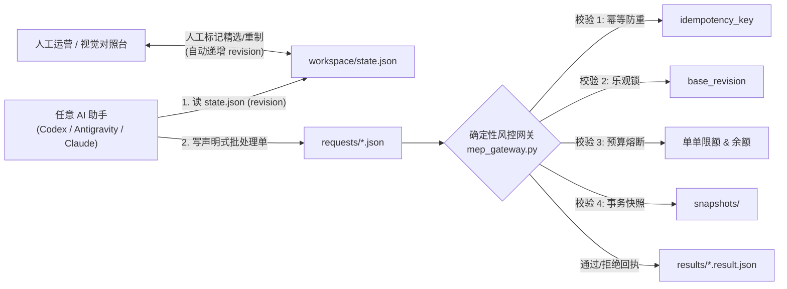

# VideoOps-MEP · 多模型 AIGC 批量内容生产受控协作协议（MVP）

> **把「AI 代理的非确定性规划」与「生产系统的确定性风控执行」彻底解耦。**
> 面向电商/服装/品牌多模型视频生产（Wan 3.0 / Kling 4.0 / Seedance），解决批量出片中 **AI 误扣费、人机筛选冲突、多 Agent 割裂、批量错改难回滚** 四大真实工程痛点。

## ⚡ 为什么做这个项目？
在真实多模型 AIGC 批量生产中，我们踩过 3 代协作方式的坑：
1. **浏览器点 UI（Computer Use）**：慢、易受改版影响，批量跑几十条视频极易点错。
2. **传统 MCP 直调**：每个 AI 客户端都要配 Server；工具一多吃光上下文 Token；更重要的是缺乏统一的**预算熔断、版本锁和整单回滚**，AI 幻觉或轮询重试极易造成重复扣费。
3. **VideoOps-MEP（文件级受控工作台）**：借鉴开源 [MEP](https://github.com/adunext/mep) 范式，把生产系统暴露为 `state.json + requests/ + results/ + snapshots/` 四个约定目录。任何 AI 助手（Codex / Antigravity / Claude Code）零插件读写 JSON 即可下单，所有变更必须通过确定性网关的四道安全护栏。

## 🏛️ 核心架构



## 🚀 10 秒本地运行（零外部依赖，仅需 Python 3）

```bash
git clone https://github.com/j6335455-cyber/video-ops-mep.git
cd video-ops-mep
python3 server.py
```

浏览器打开 **`http://127.0.0.1:8799`**，即可在可视化投屏控制台里一键体验 **4 个真实生产场景**：
1. **正常批处理下单**：AI 读取模板库，一次提交多 SKU 并发生成并扣减预算，自动生成回执与快照；
2. **拦截 AI 重复扣费 / 超预算熔断**：模拟自动化重试或幻觉超额下单 → 网关 0.01 秒硬拦截，**0 积分损失**；
3. **拦截人机冲突（乐观锁）**：人工先在视觉对照台把某条视频标为「重制」，AI 拿旧版本号提交「批量上架」→ 网关拒绝覆盖人工判断；
4. **一键整单回滚**：随时把任意历史批次原子恢复到变更前状态。

## 📂 目录一览
- `SPEC.md` — VideoOps-MEP 1.0 完整协议与错误码规范
- `engine/mep_gateway.py` — 确定性校验、执行与回滚核心引擎（支持 CLI 独立运行）
- `server.py` + `web/index.html` — 零依赖本地演示服务端与可视化投屏控制台
- `workspace/` — 真实磁盘协议目录（`state.json` / `requests/` / `results/` / `snapshots/`）
